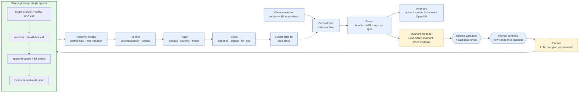
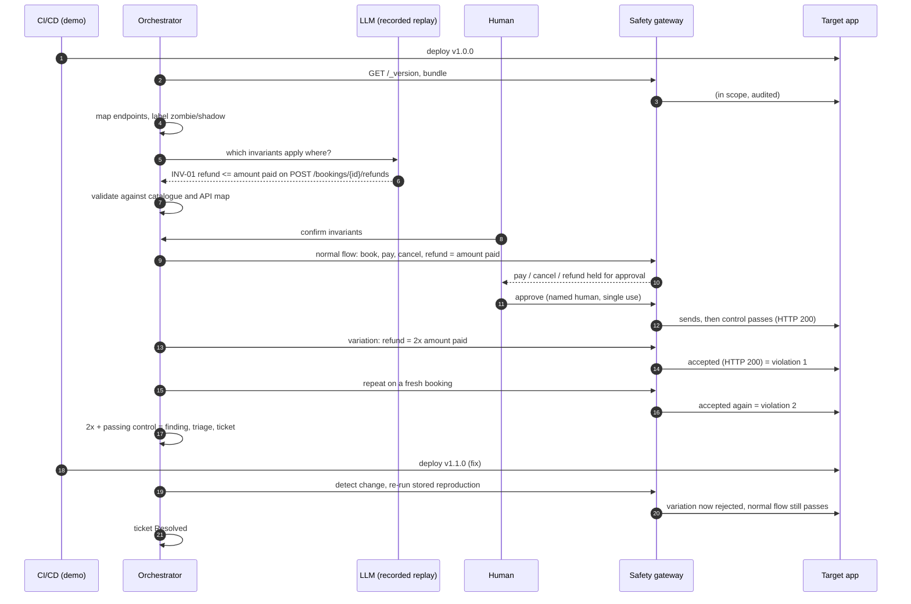
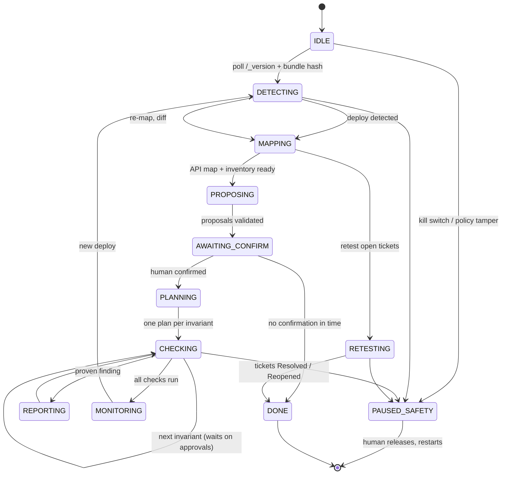
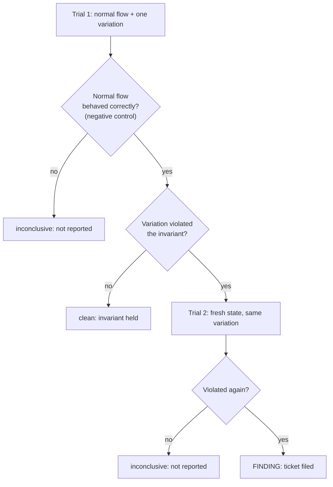

# Preflight

**VoyageHack 4.0 · Fraud Prevention & Security: Agentic Real-Time DAST**

[](https://github.com/hazelmayank/preflight-dast/actions/workflows/ci.yml)
· Repo: <https://github.com/hazelmayank/preflight-dast>

Preflight is a release-safety verification harness for a B2B travel platform. When a deploy lands it
detects the change, maps the API with no spec, and has an LLM **propose which business invariants
apply to which endpoints**. A human confirms them. Each invariant becomes a deterministic property
check: run the normal flow, make one controlled variation, assert the safe behaviour. A finding is
declared only by code, after the violation **reproduces twice against a passing control**. It is then
priced in business terms, routed to an owner, and **auto-retested after the fix**. Everything runs
only against our own synthetic target, through one safety gateway (scope allowlist, rate limit,
human approval queue, kill switch, hash-chained audit log).

> **Status: v1 MVP, runs end to end.** 8 property checks, recorded-replay LLM, minimal control room.
> Honest numbers and limits are in [docs/BENCHMARKS.md](docs/BENCHMARKS.md).

## Quickstart

```bash
make install        # python deps (3.11+)
make test           # 170 tests incl. the egress / seed-isolation / no-auto-approve guards
make demo           # the full loop, offline, ~1 minute; prints a scoreboard
make demo-live      # same, keeps the control room up at http://127.0.0.1:8001 (Ctrl-C to stop)
make demo-live MANUAL=1   # no scripted operator: you confirm and approve in the UI
```

**What `make demo` does (about 50 seconds):** starts the synthetic target and the control room,
simulates a deploy of `v1.0.0` (vulnerable), detects it, maps 21 endpoints (labels the legacy v0 route
*zombie* and the debug and webhook routes *shadow*), replays the recorded LLM proposals, waits for a
human to confirm the invariants, runs 8 checks (5 produce proven findings), files 5 tickets, then
"ships" `v1.1.0` (fixed), detects it, re-runs each stored reproduction and closes all 5 tickets, and
finally sweeps every check on the fixed build (0 false positives). Output: `out/tickets/*.md`,
`out/audit.jsonl`, `out/openapi.json` (generated from traffic, no spec) and `docs/BENCHMARKS.md`.

The scripted stand-in for the human is called `demo-operator` and is announced on screen. It lives in
`demo/`, outside the agent package.

## Architecture

LLM steps (dashed) only **propose**. Deterministic steps (solid) decide. Every request leaves
through the gateway.



### The worked example: one deploy, one finding, one fix



### Orchestrator states



### What counts as a finding



## The 8 property checks

From [specs/invariants.md](specs/invariants.md) (team-authored): INV-01 refund never exceeds amount
paid, INV-02 tenant isolation on read, INV-03 role boundary, INV-04 charged price equals quote,
INV-05 no double refund, INV-06 valid state transitions, INV-07 ownership required to modify,
INV-08 no sensitive-field exposure. Each check is a normal flow plus **one** controlled variation
that asserts the safe behaviour holds on our own app. It is a property check, not a payload library.

## Sample ticket (generated by `make demo`)

```
INV-01: POST /api/v1/bookings/{booking_id}/refunds violates 'refund_bound'
Status: Resolved · Severity: critical · Owner: payments-team (payments@waypoint.test)
Impact: INR 4,428 per attempt; about INR 44,280/day at an assumed 10 attempts/day
        (assumption, not TBO data)
Evidence (reproduced 2x, control passed):
  normal flow  admin@acme.test  POST .../BK-3001/refunds {"amount": 4428.0}  -> 200
  violation    admin@acme.test  POST .../BK-3002/refunds {"amount": 8856.0}  -> 200  (2x the amount paid)
  violation    admin@acme.test  POST .../BK-3003/refunds {"amount": 8856.0}  -> 200  (fresh booking)
Reproduce:  curl -s -X POST 'http://127.0.0.1:8000/api/v1/bookings/BK-3002/refunds' \
              -H 'Authorization: Bearer $TOKEN' -H 'Content-Type: application/json' \
              -d '{"amount": 8856.0, "reason": "customer request"}'
Suggested fix: Validate refund.amount <= booking.amount_paid on the server; reject with 400.
History: opened (v1.0.0, reproduced 2x) -> resolved (v1.1.0: invariant holds, normal flow still passes)
```

## Safety (built first; 20% of the score)

| Rule | Where | Enforced by |
|---|---|---|
| Single egress | `preflight/safety/gateway.py` is the only network I/O | `tests/test_egress_guard.py` (AST) fails the build on any other `requests`/`httpx`/`urllib`/`aiohttp`/`socket` import |
| Scope allowlist | `scope.yaml`, localhost only | refusals audited; SHA-256 of policy files trips the kill switch on tamper |
| LLM channel | separate allowlist, **empty by default** | the demo never needs it; live mode needs an explicit `llm_hosts` entry |
| Rate limit + backoff | `limits.yaml` | token bucket; exponential backoff on p90 latency or 5xx rate |
| Human approval | `reserved_actions.yaml` | pay / cancel / refund / role change / supplier callback held; approval is bound to the exact request, single use, expiring |
| No auto-approve | `approval.py`, `rulebook.py` | `tests/test_no_auto_approve.py` fails the build if agent code approves or confirms |
| Kill switch | in-memory flag + `out/KILL` | checked before every send and during every wait |
| Audit | `out/audit.jsonl` | hash chain; secrets redacted; prompt version and model logged per LLM action |
| Synthetic only, blind-ready | `seeds/` is defender-owned | `tests/test_seed_isolation.py` fails the build if `preflight/` reads `seeds/` or `target/` |

Details: [docs/SAFETY.md](docs/SAFETY.md).

## Benchmarks (seeded synthetic target)

| Metric | Result |
|---|---|
| Seeded issues found | **6 / 20** (S01, S04, S08, S09, S15, S17) |
| Findings that match a seeded issue | 5 of 5 |
| False positives on the fixed build | 0 |
| Deploy to first proof | ~7 s |
| Tickets auto-closed after the fix | 5 / 5 |
| Out-of-scope requests sent | 0 |

Full table, per-check results and every miss: [docs/BENCHMARKS.md](docs/BENCHMARKS.md).

## Limitations (stated before a judge asks)

- **Not blind.** The target and its seeded issues were written by the team that built the agent. These
  numbers are a regression score. The planned blind runs (OWASP crAPI, VAmPI, a teammate-seeded app)
  have **not** been run.
- **The LLM step is a replay of hand-authored fixtures** in `demo/recordings/`, labelled as such in the
  UI, the audit log and the benchmarks. Model quality is unmeasured. A live Anthropic provider exists
  but is untested against the real API and is closed by default.
- **Recall is 6/20.** The spec's 8 checks cover fewer issues than first estimated; injection,
  session/auth and server-side classes are out of MVP scope. INV-04, 06 and 07 are clean on the
  vulnerable build because the target already enforces those rules.
- Recon reads a regex-parsed bundle, a recorded HAR and logs. There is no browser crawl.
- Each state-changing step needs a human approval (57 in the demo, scripted by `demo-operator`).
- Severity amounts are assumptions for the synthetic app, not TBO figures.

## Layout

```
preflight/   agent: safety (gateway, approvals, kill switch, audit), recon, inventory, discovery
             (invariant schema, proposer, rulebook), llm, planning, execution (flow, 8 checks,
             verifier), triage, reporting, orchestrator, ui
target/      synthetic B2B travel API (FastAPI), vulnerable/fixed deploys, traffic generator
specs/       invariants.md: the team-authored property checks
seeds/       defender-only ground truth (git-ignored)
demo/        make demo runner, config, recorded LLM responses
bench/       scorer that compares tickets with the ground truth
tests/       unit tests, live end-to-end tests, and the build-failing guards
docs/        ARCHITECTURE, SAFETY, BENCHMARKS, DEMO_SCRIPT
```

## Ownership

Each member owns, and can explain end to end, their modules. See `docs/ARCHITECTURE.md`.
