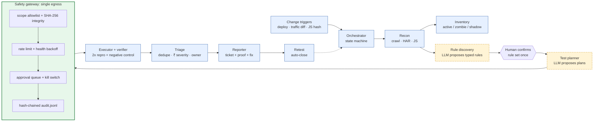

# Preflight

**VoyageHack 4.0 · Fraud Prevention & Security: Agentic Real-Time DAST**

Preflight is an autonomous security-testing agent for a B2B travel platform. On every deploy it
detects what changed, maps the API with no spec, and lets an LLM **propose the platform's own
business rules** from observed traffic. Each rule becomes a deterministic test, sent through one
safety gateway. Only findings that **reproduce twice against a clean control** are reported, each
priced in business terms, routed to an owner, and auto-retested after the fix. It runs only against
the synthetic target in this repo, inside a scope allowlist, with a human approval queue and a kill
switch. Competing submissions hard-code their rules and test apps they wrote; Preflight discovers the
rules and is scored blind on bugs it was never shown.

> **Status: Phase 0 (safety skeleton + synthetic target).** Recon, rule discovery, execution,
> triage, reporting and the UI arrive in Phases 1-4. `make demo` is a stub until Phase 4.

## Quickstart

```bash
make install        # python deps
make test           # egress guard, seed isolation, gateway, target bug matrix
make data           # synthetic 30/90-day logs + HAR of normal journeys -> target/data/
make target         # serve the synthetic target on 127.0.0.1:8000
make demo           # STUB until Phase 4
```

**What `make demo` will show (Phase 4):** a live control room where a simulated deploy is detected,
a business rule is discovered, a violation is proved twice against a control, a ticket is filed with
owner and impact, the fix is deployed and the ticket auto-closes. Under 5 minutes, with an
`audit.jsonl` and zero out-of-scope requests.

## Architecture

LLM steps (dashed) only **propose**. Deterministic steps (solid) decide. Every request leaves
through the gateway.



The sequence diagram (deploy to auto-close) and orchestrator state diagram land with Phase 1 and 4.

## Safety (built first; 20% of the score)

| Rule | Where | Enforced by |
|---|---|---|
| Single egress | `preflight/safety/gateway.py` is the only network I/O | `tests/test_egress_guard.py` (AST) fails the build on any other `requests`/`httpx`/`urllib`/`aiohttp`/`socket` import |
| Scope allowlist | `scope.yaml`, localhost only | refusals audited; SHA-256 of policy files trips the kill switch on tamper |
| Rate limit + backoff | `limits.yaml` | token bucket; exponential backoff on p90 latency or 5xx rate |
| Human approval | `reserved_actions.yaml` | pay / cancel / refund / role change / supplier callback held; approval is bound to the exact request, single-use, expiring |
| No auto-approve | `approval.py` | `tests/test_no_auto_approve.py` fails the build if agent code approves |
| Kill switch | in-memory flag + `out/KILL` | checked before every send and during every wait |
| Audit | `out/audit.jsonl` | hash chain; secrets redacted; `AuditLog.verify` detects edits |
| Synthetic only, blind | `seeds/` is defender-owned | `tests/test_seed_isolation.py` fails the build if `preflight/` reads `seeds/` or `target/` |

Details: [docs/SAFETY.md](docs/SAFETY.md).

## Layout

```
preflight/   agent: orchestrator, safety, recon, inventory, discovery, planning,
             execution, triage, reporting, ui
target/      synthetic B2B travel API (FastAPI), vulnerable/fixed modes, traffic generator
seeds/       defender-only ground truth (git-ignored)
bench/       crAPI / VAmPI / blind-seed runners (Phase 4)
tests/       unit tests plus the build-failing guards
docs/        ARCHITECTURE, SAFETY, BENCHMARKS, DEMO_SCRIPT
```

## Benchmarks

Filled in Phase 4 (`docs/BENCHMARKS.md`): recall, precision and time-to-proof on crAPI, VAmPI and
blind seeds, with misses listed.

## Limitations

- The target is synthetic. Results show generalisation on apps and bugs we did not write, not on
  TBO's real platform.
- Rule discovery depends on traffic coverage; thin journeys mean fewer rules.
- Severity in rupees uses assumed amounts, labelled as assumptions.

## Ownership

Each member owns, and can explain end to end, their modules. See `docs/ARCHITECTURE.md`.
